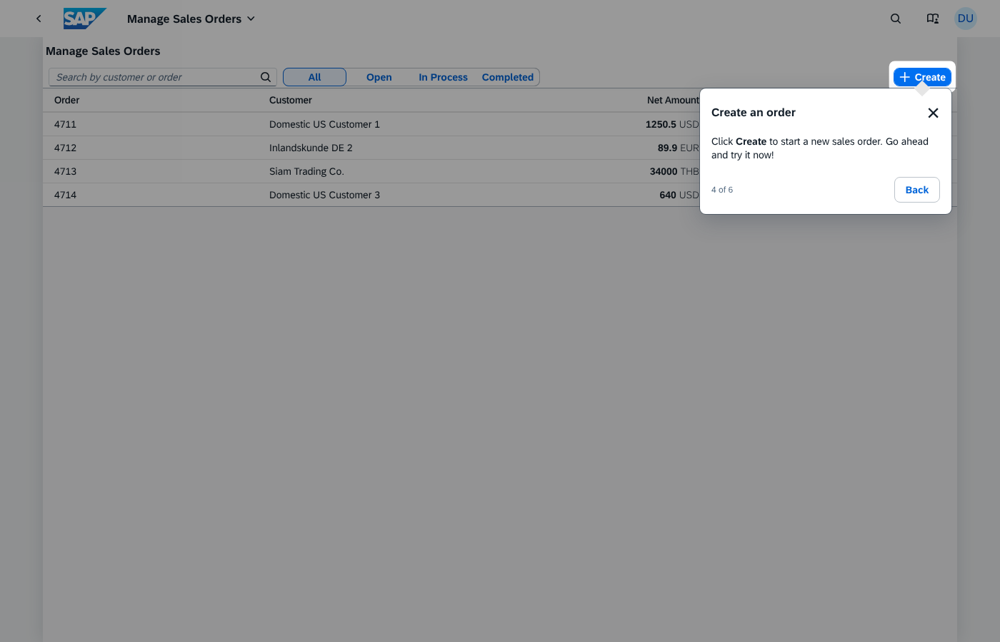
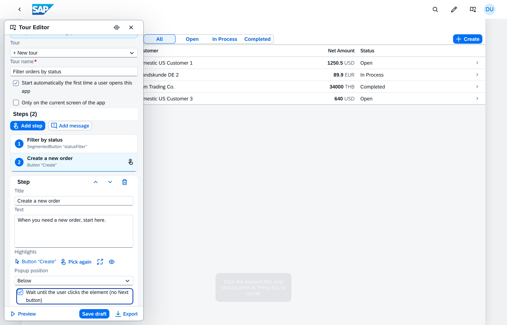
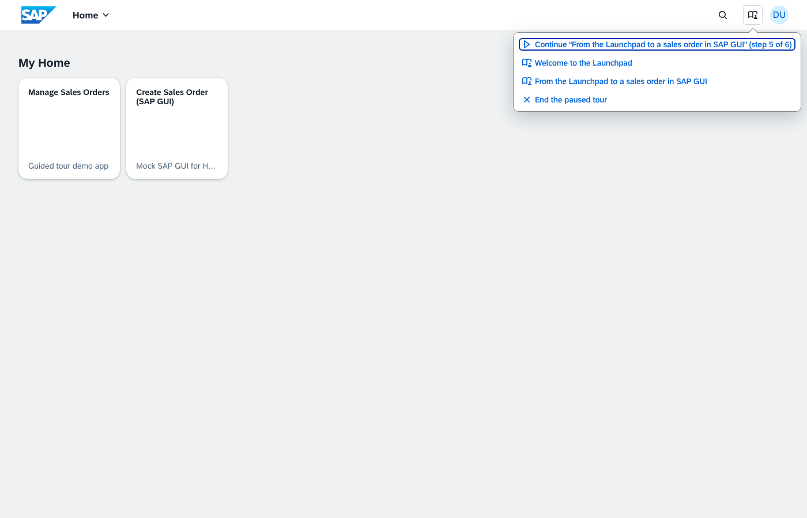

# Fiori Guided Tours (ShepherdJS plugin for SAP Fiori Launchpad)

A SAP Fiori Launchpad (FLP) plugin that shows step-by-step guided tours inside Fiori apps,
powered by [ShepherdJS](https://github.com/shepherd-pro/shepherd).

- **One plugin for every app.** The plugin loads with the Launchpad and works out which app the user is in.
  Tours are plain JSON files, so no app needs to be changed.
- **"Guided Tour" button in the shell header.** It appears only in apps that have a tour; with more than one
  tour the user picks from a list.
- **Auto-start on first visit** (per tour, remembered per user and browser). Bump a tour's `version` to show it again after a change.
- **Fiori look.** Popups use the SAP theming variables, so they follow Horizon, Quartz, dark and high-contrast themes.
- **Robust targeting.** Point steps at UI5 controls by id suffix or by control type + property, not only by CSS selector,
  because Launchpad-generated DOM ids are long and unstable.
- **Interactive steps.** A step can wait for the user to click the highlighted element (`advanceOn`), wait for a
  dialog to open (`waitFor`) and skip itself when its element isn't on screen (`skipIfMissing`).
- **Tours across apps and reloads.** A tour can start on the Launchpad home page, go on in an app and end in
  SAP GUI. It pauses when the user is somewhere else and goes on by itself, also after a page reload
  (see [Tours across apps](#tours-across-apps)).
- **Multilingual texts.** Any text can be `{ "en": "...", "de": "...", "th": "..." }`; the user's Fiori language is used.
- **Point-and-click tour editor.** Authors build tours inside the Launchpad: click "Add step", click a control,
  type the text. No JSON or ids needed (see [Tour editor](#tour-editor-no-json-needed)).
- **Lightweight.** ShepherdJS (50 KB) is only downloaded when a tour actually starts, and the editor only when an author opens it.



## Try it locally

Requires Node.js 18+.

```bash
npm install
npm start          # opens http://localhost:8080/test/flpSandbox.html
```

The sandbox Launchpad has a demo app ("Manage Sales Orders") and a mock SAP GUI for HTML screen
("Create Sales Order (SAP GUI)") for transaction code tours. Open it and its tour starts by itself.
Use the header button (book icon) to start tours again. To see the auto-start once more, run
`localStorage.clear()` in the browser console.

Open `http://localhost:8080/test/flpSandbox.html?fiori-guide-editor=true` to try the tour editor.

End-to-end tests (Playwright) drive the sandbox, one for the tours and one for the editor:

```bash
npm run serve &    # dev server on port 8080
npx playwright --version || npm i -D playwright
npm test
```

## Tour editor (no JSON needed)



1. Open the Launchpad with `?fiori-guide-editor=true` in the URL (before the `#`), e.g.
   `https://<host>/sap/bc/ui2/flp?fiori-guide-editor=true#SalesOrder-manage`. A pencil button appears in the shell header.
2. Open the app you want to explain and press the pencil. The editor panel opens on the side (the ⟷ button moves it to the other side).
3. Choose **+ New tour** (or pick an existing tour to change it) and give it a name.
4. Press **Add step**, then click the element in the app the step should point at. The click does not trigger the app.
   The editor shows what it picked and how reliable the reference is:
   - *stable*: the control has an id from the app's view (e.g. `statusFilter`)
   - *good*: found by type and text (e.g. the Button "Create")
   - *fragile*: only a CSS path; pick a labeled element or its parent instead.
   The ⤢ button switches to the surrounding, larger control (e.g. the whole filter instead of one of its buttons).
5. Type a title and text, choose where the popup appears, and optionally tick
   **Wait until the user clicks the element** for hands-on steps. **Add message** adds a centered step without an element.
6. **Preview** plays the tour, **Save draft** keeps it in this browser (only you see it, as a normal tour in the Guided Tour button).
7. **Export** produces the complete `index.json` (existing tours plus your drafts). Hand it to your Fiori administrator,
   who replaces `tours/index.json` (or the file at `toursUrl`) and deploys. Saving a changed existing tour bumps its
   `version`, so users see the updated tour once.

`enableEditor` controls access: `"url"` (default, as above), `true` (always) or `false` (never, e.g. in production).
Drafts never leave the author's browser until they are exported, so the editor is safe to leave on: other users see nothing.

## Guiding users to type a transaction code

Steps can ask the user to type something specific, such as a transaction code, and only continue once it is right.

**In SAP GUI for HTML transactions** (opened from the Launchpad, shown in an embedded page):

```json
{ "title": "Start the transaction", "text": "Type the transaction code and press Enter.", "tcode": "VA01" }
```

- The step points at the SAP GUI command field (OK-code field) automatically.
- The user types `VA01` (or `/nva01`, `/oVA01`: case and the `/n` and `/o` prefixes are ignored) and presses Enter.
  SAP GUI opens the transaction and the tour moves to the next step, which can point at fields on the new screen.
- A wrong code is stopped before it reaches SAP GUI and the popup says "Please type VA01".
  Set `"blockWrongValue": false` to let it through.
- Fields on SAP GUI screens are targets like `{ "frame": true, "selector": "[title='Sales Document Type']" }`.
  The editor creates these for you when you click a field.

**Any other field** (Launchpad search, a field in a Fiori app):

```json
{ "target": { "controlId": "searchField" }, "expectValue": "VA01", "advanceOn": "enter" }
```

`expectValue` can be one value, a list (`["VA01", "VA02"]`) or a regular expression (`"/^VA0[12]$/"`, with
`expectHint` for what to show the user). `advanceOn: "input"` continues as soon as the value is right, without Enter.

**In the editor:** press **Add T-code step** (with the SAP GUI screen open it picks the command field by itself) and
enter the code, or, for any picked field, set *Continue when* to *The user types a value (and presses Enter)*.

The tour moves on as soon as the transaction screen opens, also when SAP GUI handles the Enter key itself or
loads a new page for the transaction. In that case a wrong code can't be blocked before SAP GUI sees it; the step
simply stays until the right transaction opens.

**Limits:** this works when SAP GUI for HTML (or the other embedded page) comes from the same server as the
Launchpad, which is the normal setup on an ABAP front-end server. Browsers do not let a page look into embedded pages
from a different server, and the desktop SAP GUI (SAP Logon) is outside the browser, so neither can be guided.
The command field is found by its id `ToolbarOkCode` (and older variants); this was tested against a mock SAP GUI page,
so please try it on your system's SAP GUI for HTML first.

## Steps the guide does for the user

A step can fill in a field or click an element itself, so users see a sample value or the tour moves along a
demo without them doing every click:

```json
{ "target": { "controlId": "searchField" }, "fillValue": "Domestic", "pressEnter": true },
{ "target": { "controlType": "sap.m.Button", "text": "Create" }, "autoClick": true },
{ "target": { "controlId": "newCustomer" }, "fillValue": "ACME Corp" }
```

- `fillValue` types the value into the highlighted field. The step stays open with its Next button, so the user can
  check or change the value.
- `pressEnter: true` (with `fillValue`) also presses Enter in the field, and the tour goes on by itself.
- `autoClick: true` clicks the highlighted element (after filling it, if `fillValue` is set) and the tour goes on by itself.
- The step is shown for 1.5 seconds first so the user sees what happens; change that with `actionDelay` (milliseconds).

For UI5 apps the value is set through the control, so the app's data binding and change handlers see it as if the
user typed it. SAP GUI for HTML fields get the browser events typing and clicking cause; this was tested against the
mock SAP GUI page, so try it on your system first. Be careful with `autoClick` on buttons that save or post
something: the guide really presses them.

**In the editor:** set *Continue when* to *The guide clicks the element for the user*, and/or enter a value in
*Value the guide fills in for the user*. *Then press Enter for the user* appears once a value is entered.

## Ready-made tour: creating a sales order (VA01)

[`tours/sales-order-gui.json`](webapp/tours/sales-order-gui.json) guides a user through a standard sales order in
SAP GUI for HTML, in 16 steps:

1. Start **VA01** in the command field (skipped with Next when VA01 is already open).
2. Initial screen: order type (`OR`), sales organization, distribution channel, division, then Enter.
3. Overview: sold-to party, ship-to party, customer reference (PO number), requested delivery date.
4. First item: material and order quantity, Enter to check price and availability.
5. Save, and where to find the new order number.

The user types every value; the tour only points and explains. It is in the catalog for the intent
`SalesDocument-createGui`: change `intent` in `index.json` to the intent of the VA01 tile on your Launchpad.

Fields are found by their SAP GUI tooltip (`title`), ignoring case, with a few alternatives for different
releases, e.g. `[title='Sold-To Party' i], [title='Sold-to party number' i]`. These names were checked against the
mock SAP GUI page only. If a step appears in the middle of the screen instead of next to its field on your system,
open the tour in the [editor](#tour-editor-no-json-needed), pick the field again and export. Example values
(sales organization 1010 and so on) are the S/4HANA sample data; change the texts to your organization's values.

## Tours across apps

A tour keeps going when the user moves from one screen or app to the next:

- **Inside one app** (list to object page, SAP GUI screen to screen): nothing to do. Each step waits up to
  `waitFor` ms for its element.
- **Into another app:** give the first step of the new app an `app` field. Steps after it stay in that app until
  the next `app`. Example ([`tours/order-journey.json`](webapp/tours/order-journey.json)): Launchpad home, then
  Manage Sales Orders, then SAP GUI.

```json
{ "title": "Open the app", "target": { "controlType": "sap.m.GenericTile", "properties": { "header": "Manage Sales Orders" } }, "advanceOn": "click" },
{ "title": "Check existing orders", "app": "SalesOrder-manage", "target": { "controlId": "searchField" } },
{ "title": "Create the order in SAP GUI", "text": "Press Next to open VA01." },
{ "title": "Start the transaction", "app": { "intent": "SalesDocument-createGui", "hash": "#SalesDocument-createGui" }, "tcode": "VA01" }
```

How it behaves:

- When the user clicks a tile or link that opens the next app, the tour goes on there by itself.
- When the user presses **Next** and the next step is in another app, the plugin opens that app (from `hash`, or
  from `intent` when it has no wildcard).
- **Page reload (F5):** the tour comes back at the step the user was on.
- **The user goes somewhere else:** the tour pauses. It goes on by itself when the user opens the app again, and the
  Guided Tour button offers "Continue …" (which opens the right app) or "End the paused tour".
- **Back** is not offered into the previous app. Closing a tour (X or Esc) ends it for good.
- The progress is kept in the browser tab's `sessionStorage` for `resumeMinutes` (default 30). It is not shared with
  other tabs, so an app that opens in a **new browser tab or window** starts without the tour.



In the [tour editor](#tour-editor-no-json-needed), keep the editor open and go to the next app: the tour stays open,
and steps added there are saved with that app. Once a tour spans several apps, the step list shows each step's app.
**Preview** opens the tour's first app.

| `app` form | Meaning |
|---|---|
| `"SalesOrder-manage"` | An intent, wildcards allowed (`SalesOrder-*`), or a list of them. |
| `{ "intent": "...", "appId": "...", "innerHash": "^SalesOrder\\(", "hash": "#SalesOrder-manage&/orders" }` | Full form: app id, in-app route (regular expression) and the hash that Next / Continue open. |

## Writing tours by hand

Tours live in [`webapp/tours/`](webapp/tours). `index.json` is the catalog; each entry says which app a tour belongs to.

```json
{
  "tours": [
    {
      "id": "salesorder-overview",
      "title": { "en": "Find and create sales orders", "de": "Kundenaufträge suchen und anlegen" },
      "intent": "SalesOrder-manage",
      "version": 1,
      "url": "salesorder-overview.json"
    }
  ]
}
```

| Catalog field | Meaning |
|---|---|
| `id` | Unique id (required). |
| `title` | Shown in the tour chooser. Text or `{ "lang": "text" }`. |
| `intent` | `SemanticObject-action` of the app, wildcard (`SalesOrder-*`) or a list. `Shell-home` is the Launchpad home page. |
| `appId` | Alternative or addition to `intent`: the app's `sap.app/id` (works however the app was opened). |
| `innerHash` | Optional regular expression for the in-app route, i.e. the hash part after `&/` (e.g. `^SalesOrder\\(` for the object page). |
| `autoStart` | `true`/`false`; overrides the plugin-wide setting for this tour. |
| `version` | Number. Users who finished version 1 see the tour again automatically when you set it to 2. |
| `url` | Steps file, relative to `index.json`. Or put a `steps` array directly in the entry. |
| `modal` | `false` turns off dimming of the rest of the screen. |

A steps file:

```json
{
  "steps": [
    { "title": "Welcome", "text": "<p>This tour shows how to create a sales order.</p>" },
    { "title": "Search", "text": "Type a customer name.", "target": { "controlId": "searchField" }, "position": "bottom" },
    { "title": "Create", "text": "Click <b>Create</b>.", "target": { "controlType": "sap.m.Button", "properties": { "text": "Create" } }, "advanceOn": "click" },
    { "title": "Details", "text": "Fill in the form.", "target": { "controlId": "createDialog" }, "position": "right", "waitFor": 3000 }
  ]
}
```

| Step field | Meaning |
|---|---|
| `title`, `text` | Text or `{ "lang": "text" }`. `text` may contain simple HTML. |
| `target` | What to highlight. Leave out for a centered message. See below. |
| `position` | `top`, `bottom`, `left`, `right`, optionally with `-start` / `-end`, or `auto`. Default `bottom`. |
| `waitFor` | Milliseconds to wait for the target to appear (default 5000). If it never appears, the step is shown centered. |
| `skipIfMissing` | `true` skips the step when its target is not on screen. |
| `advanceOn` | `"click"` (or another DOM event): go to the next step when the user does this on the target. The Next button is hidden unless `showNext: true`. With `expectValue`: `"enter"` (default) or `"input"`. |
| `expectValue` | The user must type this into the target field, e.g. `"VA01"`. See [transaction codes](#guiding-users-to-type-a-transaction-code). |
| `fillValue` | The guide types this into the target field for the user. See [steps the guide does](#steps-the-guide-does-for-the-user). |
| `pressEnter` | With `fillValue`: also press Enter in the field, then go on by itself. |
| `autoClick` | `true`: the guide clicks the target for the user, then goes on by itself. |
| `actionDelay` | Milliseconds the step is shown before the guide fills / clicks (default 1500). |
| `tcode` | `"VA01"`: transaction code step in SAP GUI for HTML (command field, ignores `/n` `/o`, continues on Enter). |
| `canClickTarget` | `false` blocks clicks on the highlighted element. |
| `classes` | Extra CSS classes for the popup. |
| `app` | The app this step (and the ones after it) is shown in, for [tours across apps](#tours-across-apps). |

### Targets

| Form | Finds |
|---|---|
| `{ "controlId": "btnCreate" }` | The UI5 control whose id is `btnCreate` or ends with `--btnCreate`. This is the id from the app's XML view, so it survives the Launchpad's id prefixes. Best choice for freestyle apps and Fiori elements apps with stable ids. |
| `{ "controlType": "sap.m.Button", "properties": { "text": "Create" } }` | The first visible control of that type with those property values. Handy when an app has no stable ids. |
| `"#some .css"` or `{ "selector": "..." }` | Plain CSS selector. |
| `{ "frame": true, "selector": "..." }` | CSS selector inside an embedded page from the same server, e.g. a SAP GUI for HTML screen. |
| `{ "webgui": "okcode" }` | The SAP GUI for HTML command field. |
| `"index": 1` | (any object form) take the second visible match instead of the first. |
| `"subSelector": ".sapMInputBaseInner"` | (any object form) highlight an element inside the control. |

Tip: to find control ids, open the app, press `Ctrl+Alt+Shift+S` (UI5 Diagnostics) or use the UI5 Inspector browser extension.

## Plugin configuration

Defaults are in `manifest.json` (`sap.ui5/config/fioriGuide`). The Launchpad can override them per plugin
(target mapping parameters on ABAP, plugin `config` in the sandbox or a CDM site):

| Parameter | Default | Meaning |
|---|---|---|
| `toursUrl` | the plugin's own `tours/` folder | Where `index.json` lives. Point it to a separate BSP or static location so tours can be updated without redeploying the plugin. |
| `autoStart` | `true` | Start a tour automatically the first time a user opens its app. |
| `autoStartDelay` | `1000` | Milliseconds to wait after the app loads before auto-starting. |
| `showHeaderButton` | `true` | Show the Guided Tour button in the shell header. |
| `hideButtonWithoutTours` | `true` | Hide the button in apps that have no tour. |
| `resumeMinutes` | `30` | How long a paused or interrupted tour can be continued (in this browser tab). |
| `enableEditor` | `"url"` | Tour editor access: `"url"` (with `?fiori-guide-editor=true`), `true` or `false`. |

## Starting tours from an app

Apps can start or reset tours through the UI5 EventBus, without depending on the plugin:

```js
sap.ui.getCore().getEventBus().publish("fiori.shepherd.guide", "start", { tourId: "salesorder-overview" });
sap.ui.getCore().getEventBus().publish("fiori.shepherd.guide", "reset", { tourId: "salesorder-overview" }); // or {} for all
```

## Deploying

### SAP S/4HANA / ABAP Front-End Server (on-premise)

1. Build: `npm run build` (output in `dist/`).
2. Deploy `dist/` as a BSP application, e.g. `ZFIORI_GUIDE`, with the SAP Fiori tools deploy command
   (`npx fiori deploy`, after `npm i -D @sap/ux-ui5-tooling` and a `ui5-deploy.yaml`) or report `/UI5/UI5_REPOSITORY_LOAD`.
   Then run `/UI5/APP_INDEX_CALCULATE` for the BSP.
   The build writes every file in plain ASCII (non-ASCII characters escaped), so it works even when the server
   serves the files in a non-UTF-8 code page such as Thai. Always deploy the output of `npm run build`.
3. In the Launchpad Designer / app manager, create a technical catalog entry (or use a custom catalog) with a
   **target mapping**: semantic object `Shell`, action `plugin`, application type *SAPUI5 Fiori App*,
   URL `/sap/bc/ui5_ui5/sap/zfiori_guide`, ID `fiori.shepherd.guide`. Add plugin parameters (table above) as target mapping parameters if needed.
4. Add the catalog to the business roles whose users should get tours.
5. On newer SAP_UI releases, also activate the plugin in `/UI2/FLP_CUS_CONF` (or `/UI2/FLP_SYS_CONF`) under *FLP Plugins*.

### SAP BTP (Build Work Zone)

The plugin is a standard FLP plugin (`sap.flp.type: "plugin"`), so it can be deployed to the HTML5 Application
Repository with an MTA and added in the Site Manager's Content Manager, then assigned to a role. That needs an
`xs-app.json`, an `mta.yaml` and a `sap.cloud` section in `manifest.json`, which are not part of this first version.

## Project layout

```
webapp/
  Component.js              plugin entry: config, header button, app tracking, auto-start, EventBus API
  manifest.json             sap.flp.type = plugin, Shell-plugin inbound, default config
  lib/TourRegistry.js       loads the catalog and matches tours to the current app
  lib/TourRunner.js         turns tour JSON into a Shepherd tour (buttons, progress, advanceOn, waiting, pausing)
  lib/TourSession.js        the tour in progress, so it goes on in another app or after a reload (sessionStorage)
  lib/AppMatch.js           does "where the user is" match a tour's or step's app
  lib/TargetResolver.js     finds the DOM element for a step (controlId / controlType / CSS)
  lib/AppContext.js         intent, app id and in-app route of the current app
  lib/SeenStore.js          remembers finished tours (localStorage)
  lib/ShepherdLoader.js     lazy-loads ShepherdJS and its CSS
  lib/DraftStore.js         editor drafts in localStorage
  lib/editor/               tour editor (loaded on demand): TourEditor, ElementPicker, SelectorBuilder
  lib/thirdparty/           bundled ShepherdJS (generated, see below)
  css/guide.css             Fiori theme for the popups
  css/editor.css            editor panel and element picker
  tours/                    tour catalog and step files
  test/flpSandbox.html      local Launchpad sandbox
  test/demoapp/             demo app used by the sandbox and the smoke test
scripts/bundle-shepherd.mjs bundles ShepherdJS into webapp/lib/thirdparty
scripts/smoke-test.mjs      Playwright end-to-end test of tours
scripts/editor-test.mjs     Playwright end-to-end test of the editor
scripts/journey-test.mjs    Playwright test of a tour across apps, reload and pause/continue
scripts/editor-journey-test.mjs  Playwright test of recording a tour across apps in the editor
scripts/gui-strict-test.mjs Playwright test of a T-code step against a stricter SAP GUI mock
scripts/sales-order-test.mjs Playwright test that plays the VA01 sales order tour on the SAP GUI mock
```

## ShepherdJS version and license

The bundled ShepherdJS is pinned to **13.0.0, the last MIT-licensed release**. From 14.0 on, ShepherdJS is
dual-licensed under AGPL-3.0 or a paid commercial license, which usually does not suit internal SAP landscapes.
To upgrade anyway, change the version in `package.json` and run `npm run build:shepherd`.

The bundled file is committed so the plugin can be deployed without a build step. Its dependencies
(`@floating-ui/dom`, MIT; `deepmerge-ts`, BSD-3-Clause) are included in it.
